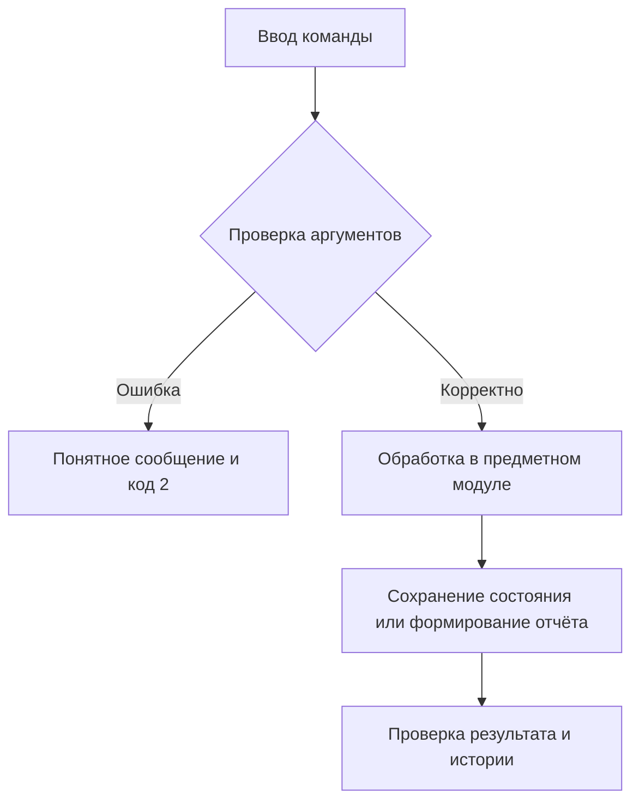

# Отчёт. Практическая работа №19–20

## Задание 7. Аудит конфигурации проекта

Дата: 5 ноября 2026 года.

## Цель

Разработать работающее приложение по заданию 7, проверить корректность,
организовать версионность и документировать применённые практики управления конфигурацией.

## Архитектура

Отдельный audit-rules.json; безопасное чтение JSON/TOML, проверки Git и файлов; JSON и HTML с экранированием текста.

Стек: Python 3.11/3.12, стандартная библиотека, pytest 8.3.5, ruff 0.11.13;
сборщик hatchling 1.27.0. Зависимости фиксируются в pyproject.toml и uv.lock.
Консольный интерфейс — src/configuration_auditor/cli.py, логика — src/configuration_auditor/core.py,
тесты — tests/. Платформа задания 8 отдельно определяет схему в storage.py.

## Схема алгоритма

Чтение правил → валидация → файлы / версия / Git / коммиты / CI → критичность → JSON + HTML.



## Основной фрагмент реализации

Код из src/configuration_auditor/core.py, функция audit:

```python
def audit(directory, rules_path):
    root = Path(directory).resolve()
    findings = []
    try:
        rules = load_rules(rules_path)
    except ValueError as exc:
        return {
            "passed": False,
            "findings": [
                {"rule": "config", "severity": "error", "passed": False, "message": str(exc)}
            ],
        }
```

Полный исходный код находится рядом с отчётом. Для защиты работы следует разобрать
его самостоятельно; происхождение реализации не представляется как подтверждение
самостоятельного написания студентом.

## Запуск и полученные результаты

Команда демонстрации: `uv run python examples/demo.py` в отдельно клонированном проекте;
в общем workspace: `uv run --all-packages python configuration-auditor/examples/demo.py` из корня.

```text
Соответствующий проект: True ; нарушающий: False
```

Основное свидетельство: [examples/compliant.json](examples/compliant.json).
Локальные тесты: **19 passed in 1.18s**. Ruff и справка CLI: успешно.
Полный протокол: [examples/verification.txt](examples/verification.txt).
Общий набор: **128 тестов пройдены на Python 3.12.14 и Python 3.11.16**.
Эти протоколы получены локально и не выдаются за GitHub Actions.

## Git и прослеживаемость

Каждый каталог — отдельный настоящий Git-репозиторий. История создавалась по этапам:
настройка пакета → функции → CLI → тесты → документация → демонстрации и проверка.
Функциональные ветки сохраняются после локального слияния; дата коммитов не подменялась.
Тег v1.0.0 фиксирует завершённое локальное состояние.

```text
feature-core
main
```

Проверка: `git log --graph --oneline --all`, `git branch`, `git tag`, `git show v1.0.0`.
Подробные снимки всех репозиториев собраны в ../git-evidence.json.

Отчёты examples/compliant.json/.html и noncompliant.json/.html показывают
проект без нарушений и проект с нарушениями правил.

## Недостающие внешние свидетельства

Workflow YAML подготовлен. Репозиторий не опубликован, URL реальных запусков
GitHub Actions пока нет. Для сдачи нужны ссылки или скриншоты, перечисленные
в CI_EVIDENCE.md. Публикация требует отдельного разрешения пользователя.

## Ограничения и вывод

Проверяется наличие непустого YAML workflow, а не его корректность или реальные запуски. Правила внутренние, результат не является сертификацией ISO/IEC/IEEE 828.

Приложение выполняет локальные функциональные требования и имеет автоматизированные
проверки. Реализованные практики SCM и организационные правила описаны в SCMP.md.
Использование отдельных принципов ISO/IEC/IEEE 828:2012 не доказывает полного
соответствия стандарту. GitHub-подтверждения, где они требуются, остаются отдельным
внешним этапом до окончательной сдачи.
